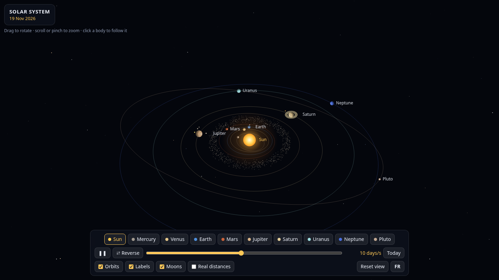

# Solar System

An interactive solar system simulation in a single, dependency-free HTML file.

**[Live demo](https://fbastin.github.io/SolarSystem/)** — or open `index.html` in a browser.

- Planets and Pluto follow their real Keplerian orbits, positioned for the actual date
- Drag to rotate, scroll or pinch to zoom, click a body to follow it
- Time controls: play/pause (Space), reverse (R), speed from hours to years per second
- Toggles for orbits, labels, moons, and real vs. compressed distances
- A six-step lesson on what an orbit is and the plane of an orbit: ellipses, the ecliptic, inclination and nodes, and how Earth's axial tilt differs from the tilt of an orbit. Open it with the Lesson button, or with `#orbit` at the end of the address
- In English and in French: `?lang=en` or `?lang=fr` in the URL, otherwise the FR/EN button's last choice, otherwise the browser's language

Body sizes and moon orbit radii are exaggerated for visibility.

## Serving it on another site

Copy `index.html` as is. To add something that follows the language, such as a link back to your site in the top-left panel (`#header`), add a script after the page's own: `Site.lang` is the current language (`'en'` or `'fr'`) and `Site.onLang(fn)` calls `fn` with the new one on every switch.

## License

[MIT](LICENSE)
